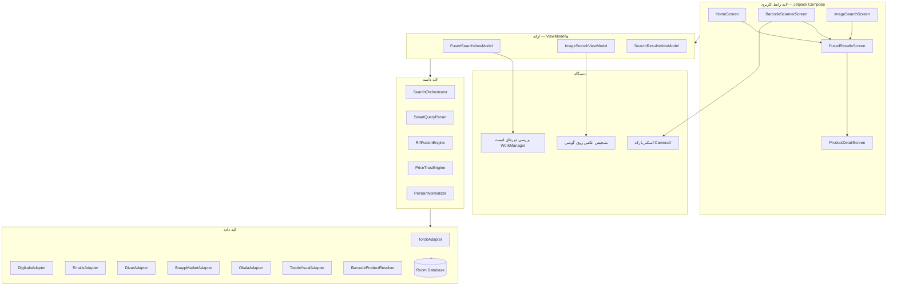

<div align="center">

[🇺🇸 English](README.md)


# ارزان‌یاب

**مقایسه قیمت با حفظ حریم خصوصی، برای خریداران ایرانی — ارزان‌ترین قیمت، در چند ثانیه.**

جست‌وجو با **متن**، **بارکد** یا **عکس** در شش فروشگاه بزرگ ایرانی.
هر جست‌وجو به‌صورت زنده روی API واقعی فروشگاه‌ها اجرا می‌شود، نتایج ترکیب،
یکپارچه و بر اساس قیمت مرتب می‌شوند — همه‌چیز روی گوشی شما، بدون هیچ سرور واسطی.

</div>

---

## ✨ امکانات

| | |
|---|---|
| 🔍 **جست‌وجوی متنی** | فهم فارسی پرس‌وجو — بازه قیمت («زیر ۱۰ میلیون») و مرتب‌سازی («ارزان‌ترین» / «گران‌ترین») مستقیم از جمله‌ای که می‌نویسید استخراج می‌شود |
| 📷 **جست‌وجو با عکس** | از کالا عکس بگیرید یا از گالری انتخاب کنید: تشخیص روی گوشی کالا را شناسایی می‌کند و بعد قیمتش در همه منابع جست‌وجو می‌شود |
| 🏷️ **جست‌وجوی بارکد** | هر بارکدی را اسکن کنید — اول به نام واقعی کالا تبدیل می‌شود تا به‌جای نتایج بی‌ربط، نتیجه درست بگیرید |
| 🔀 **جست‌وجوی ترکیبی** | متن + بارکد + عکس را در یک جست‌وجو ترکیب کنید؛ نتایج با روش Reciprocal Rank Fusion ادغام می‌شوند |
| 💰 **هوش قیمتی** | حذف قیمت‌های فریبنده (آگهی‌های نمادین ۱/۱۰/۱۰۰ تومانی فیلتر می‌شوند)، تشخیص قیمت پرت، یکسان‌سازی قیمت منابع |
| 📉 **پیگیری قیمت** | کالاها را زیر نظر بگیرید و از کاهش قیمت با اعلان باخبر شوید |
| 🕵️ **حریم خصوصی** | بدون حساب کاربری، بدون تحلیل رفتار، بدون سرور ارزان‌یاب — جست‌وجوهای شما هیچ‌جا ذخیره نمی‌شود |

## 🏪 منابع داده

| منبع | روش |
|---|---|
| **ترب** | API رسمی نسخه ۴ (جست‌وجوی متنی + جست‌وجو با عکس) |
| **دیجی‌کالا** | API رسمی نسخه ۱ |
| **ایمالز** | فید مقایسه قیمت |
| **دیوار** | API آگهی‌ها |
| **اسنپ‌مارکت** | API جست‌وجوی موبایل |
| **اکالا** | کاتالوگ مهمان با تطبیق دسته‌بندی |

هر منبع یک آداپتور مستقل با ایزولاسیون خطا دارد — اگر یک منبع از کار بیفتد،
بقیه به کار ادامه می‌دهند و خطا گزارش می‌شود، نه اینکه کل جست‌وجو بخوابد.

## 🏗️ معماری

معماری تمیز (Clean Architecture) با جریان داده یک‌طرفه، ساخته‌شده با ابزارهای مدرن اندروید.



### نقش ماژول‌ها

| پکیج | مسئولیت |
|---|---|
| `ui` | صفحه‌های Compose، ناوبری، تم (سیستم طراحی زمردی + طلایی) |
| `domain/engine` | `SearchOrchestrator` — اجرای موازی روی آداپتورها با ایزولاسیون خطای هر منبع؛ `SmartQueryParser` — فهم فارسی پرس‌وجو؛ `PriceTrustEngine` — فیلتر قیمت فریبنده و پرت |
| `domain/fusion` | `RrfFusionEngine` — ترکیب رتبه‌ای نتایج منابع (Reciprocal Rank Fusion) و حذف تکراری‌ها |
| `domain/normalizer` | نرمال‌سازی متن فارسی، پارس قیمت (تومان/ریال، ارقام فارسی) |
| `data/adapter` | برای هر فروشگاه یک آداپتور که API اختصاصی آن را به مدل یکپارچه `Product` نگاشت می‌کند |
| `data/resolver` | تبدیل بارکد به نام کالا پیش از جست‌وجو |
| `data/local` | دیتابیس Room — کالاهای تحت نظر، تاریخچه جست‌وجو، کاتالوگ تصویری |
| `ml` | برچسب‌گذاری عکس روی گوشی + نگاشت فارسی برچسب‌ها (در این مسیر هیچ عکسی از گوشی خارج نمی‌شود) |
| `scanner` | پایپ‌لاین اسکن بارکد با CameraX |
| `work` | بررسی پس‌زمینه‌ای کاهش قیمت با WorkManager |

### مسیر جست‌وجو

```
پرس‌وجو ──▶ SmartQueryParser ──▶ اجرای موازی روی ۶ منبع
  (بازه قیمت و نوع مرتب‌سازی      │ با supervisorScope: خرابی یک منبع
   از متن فارسی استخراج می‌شود)    │ جست‌وجو را از کار نمی‌اندازد
                                   ▼
              نرمال‌سازی ──▶ ترکیب RRF ──▶ حذف تکراری ──▶
              PriceTrustEngine ──▶ نتایج مرتب‌شده
```

## 🛠️ تکنولوژی‌ها

- **زبان:** Kotlin
- **رابط کاربری:** Jetpack Compose (Material 3)، Navigation Compose
- **هم‌زمانی:** Coroutines + Flow، ‏`supervisorScope` برای اجرای موازی با ایزولاسیون خطا
- **ذخیره‌سازی:** Room، DataStore
- **پس‌زمینه:** WorkManager
- **دوربین:** CameraX + اسکن بارکد ML Kit
- **تشخیص عکس:** برچسب‌گذاری روی گوشی ML Kit (مدل همراه برنامه)
- **شبکه:** Retrofit / OkHttp
- **مرورگر:** AndroidX Custom Tabs (باز شدن صفحه محصول داخل برنامه)
- **حداقل SDK:** ‏۲۶ · **SDK هدف:** ‏۳۵

## 🚀 ساخت

پیش‌نیاز: آخرین نسخه پایدار Android Studio، JDK 17، و یک گوشی واقعی برای امکانات دوربین.

```bash
git clone https://github.com/alikali68/ArzanYab.git
cd ArzanYab
```

۱. پروژه را در Android Studio باز کنید و بگذارید Gradle سینک شود (در برخی مناطق برای دسترسی به مخازن Maven ممکن است VPN لازم باشد).
۲. سه فایل فونت وزیرمتن را در `app/src/main/res/font/` بگذارید:
   `vazirmatn_regular.ttf`‏، `vazirmatn_medium.ttf`‏، `vazirmatn_bold.ttf`
۳. روی گوشی واقعی اجرا کنید — دوربین شبیه‌ساز برای جست‌وجوی واقعی بارکد/عکس جواب نمی‌دهد.

## 🔒 حریم خصوصی

- هیچ سرور واسطی برای این برنامه وجود ندارد: درخواست‌ها مستقیم از گوشی شما به APIهای عمومی فروشگاه‌ها می‌روند.
- بدون حساب کاربری، بدون SDK تحلیل رفتار، بدون ردیاب تبلیغاتی.
- جست‌وجوی تصویری ترب اول عکس را روی یک هاست موقت عمومی آپلود می‌کند — برنامه پیش از هر
  آپلود رضایت صریح شما را می‌گیرد، و مسیر تشخیص روی گوشی هیچ‌چیز را آپلود نمی‌کند.

## 📄 لایسنس

کلیه حقوق محفوظ است © علی ملکی.

---

<div align="center">

**ساخته‌شده توسط [علی ملکی](https://github.com/alikali68)** · [ایکس](https://x.com/alikali68)

</div>
