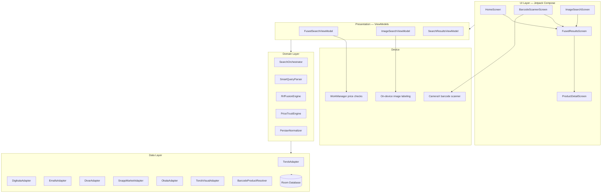

<div align="center">

[🇮🇷 فارسی](README.fa.md)


# ArzanYab

**Privacy-first price comparison for Iranian shoppers — find the cheapest price, in seconds.**

Search by **text**, **barcode**, or **photo** across six major Iranian marketplaces.
Every query runs live against real store APIs, results are fused, de-duplicated and
ranked by price — entirely on your device, with no backend server in between.

</div>

---

## ✨ Features

| | |
|---|---|
| 🔍 **Text search** | Persian-aware query processing — understands price ranges ("under 10 million"), "cheapest" / "most expensive" sorting, straight from the sentence you type |
| 📷 **Photo search** | Snap a product or pick from gallery: on-device image recognition identifies the item, then searches every source for its price |
| 🏷️ **Barcode search** | Scan any barcode — resolved to the real product name first, so you get relevant results instead of raw-number noise |
| 🔀 **Fused search** | Combine text + barcode + photo in one query; results merged with Reciprocal Rank Fusion |
| 💰 **Price intelligence** | Bait-price rejection (symbolic 1/10/100-toman listings are filtered out), outlier detection, per-source price normalization |
| 📉 **Price tracking** | Watch products and get notified of price drops via background workers |
| 🕵️ **Privacy-first** | No accounts, no analytics, no ArzanYab server — your searches never leave your phone except to the stores you query |

## 🏪 Data sources

| Source | Method |
|---|---|
| **Torob** | Official v4 search API (text + search-by-image) |
| **Digikala** | Official v1 search API |
| **Emalls** | Price-comparison feed |
| **Divar** | Classified listings API |
| **Snapp Market** | Mobile search API |
| **Okala** | Category-matched guest catalog |

Each source has a dedicated, fault-isolated adapter — if one source fails,
the rest keep working and the failure is reported instead of crashing the search.

## 🏗️ Architecture

Clean Architecture with unidirectional data flow, built with modern Android tooling.



### Module overview

| Package | Responsibility |
|---|---|
| `ui` | Compose screens, navigation, theme (emerald + gold design system) |
| `domain/engine` | `SearchOrchestrator` — parallel fan-out to adapters with per-source fault isolation; `SmartQueryParser` — Persian natural-language query understanding; `PriceTrustEngine` — bait-price & outlier filtering |
| `domain/fusion` | `RrfFusionEngine` — Reciprocal Rank Fusion across sources, cross-source de-duplication |
| `domain/normalizer` | Persian text normalization, price parsing (تومان/ریال, Persian digits) |
| `data/adapter` | One adapter per marketplace, each mapping its native API to a unified `Product` model |
| `data/resolver` | Barcode → product-name resolution before search |
| `data/local` | Room database — tracked products, search history, visual catalog |
| `ml` | On-device image labeling + Persian label mapping (no photo ever leaves the phone for this path) |
| `scanner` | CameraX barcode scanning pipeline |
| `work` | WorkManager-based background price-drop checks |

### Search pipeline

```
Query ──▶ SmartQueryParser ──▶ parallel adapter fan-out (6 sources)
   (price range, sort intent          │ supervisorScope: one source
    extracted from Persian text)      │ failing never kills the search
                                     ▼
                          normalize ──▶ RRF fusion ──▶ de-dupe ──▶
                          PriceTrustEngine ──▶ ranked results
```

## 🛠️ Tech stack

- **Language:** Kotlin
- **UI:** Jetpack Compose (Material 3), Navigation Compose
- **Concurrency:** Coroutines + Flow, `supervisorScope` for fault-isolated fan-out
- **Persistence:** Room, DataStore
- **Background:** WorkManager
- **Camera:** CameraX + ML Kit barcode scanning
- **Image recognition:** ML Kit on-device image labeling (bundled model)
- **Networking:** Retrofit / OkHttp
- **Browser:** AndroidX Custom Tabs (in-app product pages)
- **Min SDK:** 26 · **Target SDK:** 35

## 🚀 Build

Requirements: Android Studio (latest stable), JDK 17, a physical device for camera features.

```bash
git clone https://github.com/alikali68/ArzanYab.git
cd ArzanYab
```

1. Open the project in Android Studio and let Gradle sync (a VPN may be needed to reach Maven repositories from some regions).
2. Add the three Vazirmatn font files to `app/src/main/res/font/`:
   `vazirmatn_regular.ttf`, `vazirmatn_medium.ttf`, `vazirmatn_bold.ttf`
3. Run on a real device — the emulator camera cannot do real barcode/photo search.

## 🔒 Privacy

- No backend server operated for this app: queries go directly from your phone to the public store APIs.
- No accounts, no analytics SDKs, no ad trackers.
- Photo search via Torob's search-by-image uploads the photo to a temporary public
  host first — the app asks for explicit consent before every upload, and the
  on-device recognition path never uploads anything.

## 📄 License

All rights reserved © Ali Maleki.

---

<div align="center">

**Built by [Ali Maleki](https://github.com/alikali68)** · [X](https://x.com/alikali68)

</div>
